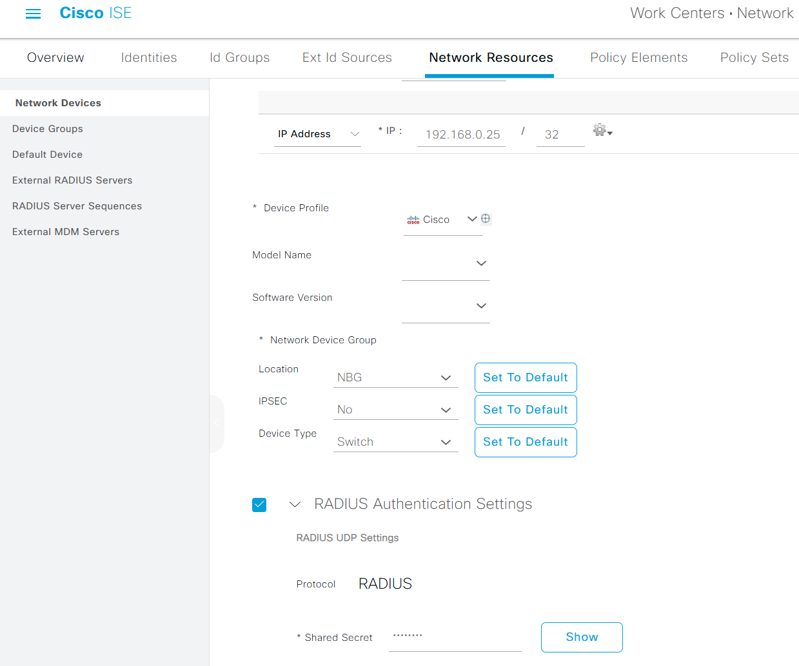
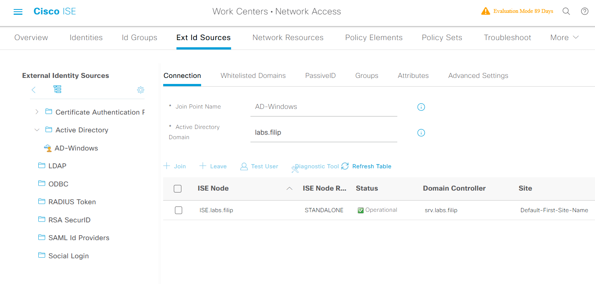
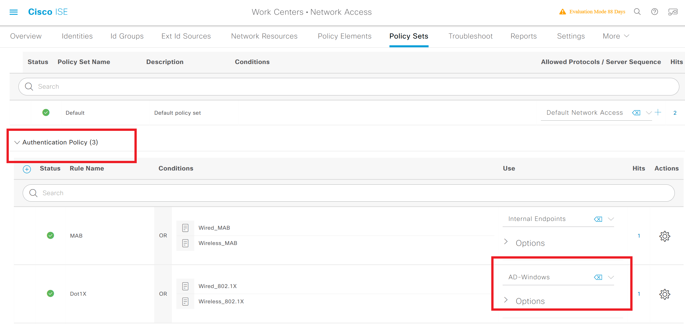
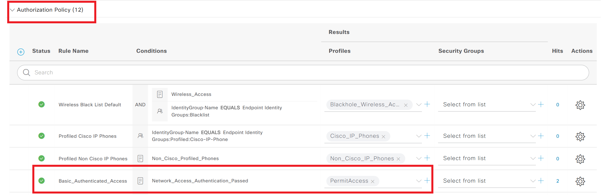
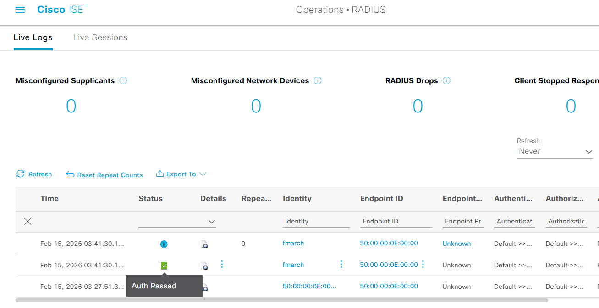

## From Theory to Practice

In the previous post, we explored the theoretical framework of 802.1X, how the Extensible Authentication Protocol (EAP) works, and why methods like PEAP are crucial for securing your network access.

Now, it's time to get our hands dirty. In this article, I will show you how to configure the **Authenticator** (a Cisco Nexus switch running NX-OS) and point it to our **Authentication Server** (Cisco ISE), which is integrated with Microsoft Active Directory.

Based on our topology, we have a Windows PC (Supplicant) connected to a Cisco NX-OS switch, which in turn communicates with Cisco ISE. Let's break down the configuration step by step.

---

## Step 1: Global AAA and RADIUS Configuration

Before we can enforce port security, we need to teach our switch how to talk to the RADIUS server and enable the necessary features.

Here is the global configuration required on the Nexus switch:

```text
! Enable the required features
feature dot1x

! Define the RADIUS server (Cisco ISE)
radius-server host 192.168.0.10 key 0 Cisco123 [acct-port ] [auth-port ]

! Group the RADIUS servers (useful if you have multiple ISE nodes)
aaa group server radius ISE-SERVERS
    server 192.168.0.10

! Enable 802.1X authentication globally and tie it to our server group
aaa authentication dot1x default group ISE-SERVERS

```

### What is happening here?

* **`feature dot1x`**: Unlike classic Cisco IOS, NX-OS is modular. You must explicitly enable the 802.1X feature before you can use any related commands.
* **`radius-server host ...`**: We are defining our Cisco ISE node (`192.168.0.10`) and setting the shared secret key (`Cisco123`). **Important:** This exact same key must be configured in Cisco ISE when you add this switch as a Network Device.
* **`aaa authentication dot1x ...`**: This command tells the switch, "Whenever you need to authenticate a dot1x session, ask the servers in the `ISE-SERVERS` group."

---

## Step 2: Interface Configuration (The Authenticator)

With the global settings out of the way, we need to configure the actual access ports where our users plug in. Let's look at `Ethernet1/1`.

```text
interface Ethernet1/1
  switchport
  switchport access vlan 20
  
  ! 802.1X specific commands
  dot1x pae authenticator
  dot1x port-control auto
  dot1x host-mode single-host
  dot1x mac-auth-bypass
```

### Breaking down the port config:

* **`dot1x pae authenticator`**: Enables the Port Access Entity (PAE) role on this interface, meaning it will now act as the Authenticator for the supplicant.
* **`dot1x port-control auto`**: This is the magic command. `auto` means the port will begin in an unauthorized state (blocking traffic) and will only transition to an authorized state (forwarding traffic) after successful authentication.
* **`dot1x host-mode single-host`**: This restricts the port to allow only *one* authenticated MAC address at a time. It provides maximum security but will cause issues if a user connects an unmanaged switch to the port. *(Note: If you need to support multiple devices, like a PC connected behind an IP Phone, you would use `multi-domain` or `multi-host`.)
* **`dot1x mac-auth-bypass`**: Enables **MAB** (MAC Authentication Bypass) on the port. As discussed in the previous article, if a device (like a printer) does not respond to 802.1X EAPOL requests, the switch will fall back to sending its MAC address to ISE for authentication.

---

## Step 3: Cisco ISE & AD Configuration

Now that the switch is ready to forward authentication requests, we need to ensure Cisco ISE is ready to process them.

### 1. Adding the Switch to ISE

First, the Nexus switch must be added as a Network Device in ISE. This ensures ISE trusts the incoming RADIUS packets.


*Figure 1: Adding Switch to ISE*

### 2. Validating Users against Active Directory

Since we want users to log in with their domain credentials, ISE must be joined to Microsoft Active Directory.


*Figure 2: Adding AD to ISE*


### 3. Policy Sets: Tying it all together

When an authentication request hits ISE, it evaluates it against a **Policy Set**.

* **Authentication Policy:** Tells ISE *where* to check the credentials (in our case, Active Directory).
* **Authorization Policy:** Tells ISE *what to do* if the credentials are valid (e.g., send a RADIUS Access-Accept message, assign VLAN 20, or push a Downloadable ACL).


*Figure 3: ISE Authentication Policy*



*Figure 4: ISE Authorization Policy*

---

## Verifying the Connection

Once everything is wired up, plugging in our Windows Supplicant triggers the flow. As soon as the user enters their credentials, the switch relays them to ISE, ISE checks them against AD, and access is granted!

We can verify this directly on the Nexus switch using the CLI:

```text
Access-Switch# show dot1x interface ethernet 1/1 details
Dot1x Info for Ethernet1/1
-----------------------------------
                      PAE = AUTHENTICATOR
              PortControl = AUTO
                 HostMode = SINGLE HOST
         ReAuthentication = Disabled
              QuietPeriod = 60
            ServerTimeout = 30
              SuppTimeout = 30
             ReAuthPeriod = 3600 (Locally configured)
                ReAuthMax = 2
                   MaxReq = 2
                 TxPeriod = 30
          RateLimitPeriod = 0
         InactivityPeriod = 0
          Mac-Auth-Bypass = Enabled

Dot1x Authenticator Client List
-------------------------------
               Supplicant = 50:00:00:0E:00:00
                   Domain = DATA
            Auth SM State = AUTHENTICATED
       Auth BEND SM State = IDLE
              Port Status = AUTHORIZED
    Authentication Method = EAP
         Authenticated By = Remote Server
                Auth-Vlan = 20
             DACL-Applied = False

```

And in the ISE Live Logs, we see the green checkmark of success:


*Figure 4: 802.1X Authentication Succesful*

---

## Fine-tuning and Troubleshooting Commands

While the basic configuration gets you up and running, a production network often requires fine-tuning. Depending on the devices connecting to your network, you might need to adjust timers or periodically re-verify access.

Here are some of the most essential NX-OS `dot1x` commands you should keep in your toolbelt:

### 1. Speeding up MAB Fallback (Timers)

When an endpoint (like a printer or IP camera) doesn't support 802.1X, the switch waits for a response before falling back to MAC Authentication Bypass (MAB). By default, this wait time can be around 30 seconds or more, which delays network access for legitimate devices. You can speed up this fallback mechanism using these interface commands:

* **`dot1x timeout tx-period <seconds>`**: This defines how long the switch waits for a response to its EAP-Request/Identity frame. Changing this to `10` seconds forces the switch to realize much faster that the device is unresponsive.
* **`dot1x max-req <count>`**: This defines the maximum number of times the switch will send an EAP request before giving up. The default is 2.

> If you set `tx-period` to 10 and `max-req` to 2, the switch will give up on 802.1X and trigger MAB in just 20 seconds, drastically speeding up access for non-802.1X devices.
> {: .prompt-tip }

### 2. Periodic Re-Authentication

By default, once a device is authenticated, it stays authenticated until the link goes down. For higher security, you can force the switch to periodically re-verify the device's identity without dropping the connection:

* **`dot1x re-authentication`**: Enables periodic re-authentication on the interface.
* **`dot1x timeout re-authperiod <seconds>`**: Defines how often the re-authentication occurs. The default is usually 3600 seconds (1 hour).

### 3. Verification & Troubleshooting CLI Commands

When a user complains they can't access the network, these operational commands will tell you exactly what is happening:

* **`show dot1x all details`**: The ultimate command to see the 802.1X state of all ports. It displays the client's MAC address, the authentication method used, and the current port status.
* **`clear dot1x interface ethernet 1/1`**: Manually forces the port to restart the entire authentication process. This is incredibly useful during lab testing because you don't have to physically unplug and re-plug the cable.
* **`show radius-server statistics`**: Helps you verify if the switch is actually sending RADIUS packets to Cisco ISE and if ISE is responding.
* **`show dot1x interface e1/1 statistics`**:To verify if the switch and the endpoint are actually exchanging 802.1X frames (EAPOL).
* **`debug dot1x all`**: If everything else fails, this command prints real-time logs of the 802.1X state machine, EAPOL frames, and RADIUS messages directly to your console. *(Warning: Use this with caution on heavily populated production switches!)*

---

## Conclusion

You've just seen the end-to-end configuration required to deploy basic 802.1X port security. By combining the flexibility of Cisco NX-OS, the policy engine of ISE, and the identity store of AD, you effectively eliminate the "plug and play" risk in your local network.
